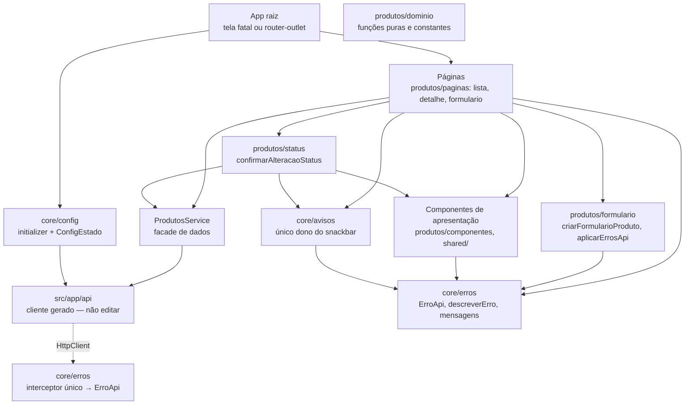
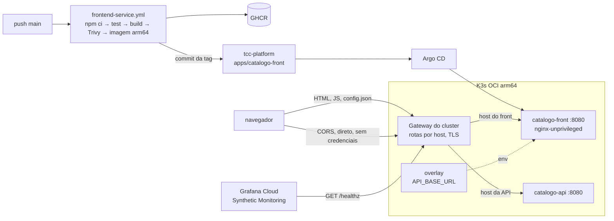

# Architecture Spine — catalogo-front

## Design Paradigm

**SPA em camadas por feature**, com componentes standalone, signals, zoneless e sem `NgModule`. A única feature é `produtos/`, `core/` reúne o que é transversal e `shared/` guarda a apresentação genérica. A dependência só desce, como no diagrama (AD-1).



`produtos/dominio` (limites, conversão de números, leitura de id e da consulta) só tem funções puras e constantes, sem `inject()`, e qualquer camada pode importá-lo.

## Invariants & Rules

### AD-1 — Direção de dependência e uma única porta para a API [ADOPTED]

- **Binds:** all
- **Prevents:** página chamando `HttpClient` ou o cliente gerado direto; duas formas de chamar a mesma rota; componente de apresentação buscando dados.
- **Rule:**
  - As dependências seguem só as setas do diagrama.
  - Só `ProdutosService` importa de `src/app/api`, e o ESLint (`no-restricted-imports`) bloqueia qualquer outro import.
  - Fora de `core/` e do código gerado, ninguém injeta `HttpClient`.
  - Componentes de apresentação recebem dados por `input()` e emitem por `output()`. Eles não injetam o facade, `Router` nem `MatSnackBar`.
  - As chamadas à API não levam credenciais (`withCredentials` fica desligado) nem cabeçalhos próprios. Assim o CORS da API fica nas requisições simples ou com preflight padrão.

### AD-2 — Cliente HTTP gerado do OpenAPI versionado [ADOPTED]

- **Binds:** CAP-1..CAP-5, CAP-8
- **Prevents:** tipos de produto escritos à mão divergindo da API; rota ou enum digitado errado; código gerado editado à mão e depois sobrescrito; chamadas em Promise que não cancelam.
- **Rule:**
  - **Fonte:** `openapi/catalogo-api.json`, cópia versionada de `/openapi/v1.json` da API. Ela muda só por commit deliberado, quando o contrato da API muda.
  - **Geração:** `ng-openapi-gen` com `ng-openapi-gen.json` (`input` = a cópia, `output: src/app/api`, `enumStyle: alias`, `promises: false`). `src/app/api/` está no `.gitignore` e nunca é editado.
  - A geração roda nos hooks `prestart`, `pretest` e `prebuild` do `package.json`. Assim `npm test`, `npm run build` (esteira) e o Dockerfile sempre geram o cliente.
  - **Facade:** os métodos de `ProdutosService` chamam `Api.invoke(fn, params)` e devolvem só `Observable` do corpo da resposta. Não há Promise nem `subscribe` dentro do facade.
  - **Tipos:** os tipos de produto, de listagem e os enums vêm só do código gerado. O front não declara `interface Produto` própria, e os enums trafegam pelo nome (AD-7 da API).
  - **Números:** o OpenAPI do .NET 10 tipa os números como `number | string`. O front envia sempre número JSON e normaliza para `number` na leitura, com o conversor de `produtos/dominio`.

### AD-3 — URL da API só em tempo de execução, antes do bootstrap [ADOPTED]

- **Binds:** CAP-6
- **Prevents:** URL no bundle ou em `environment.ts`; chamada saindo antes da URL existir ou para o próprio host do front; página em branco quando a config falha.
- **Rule:**
  - Não há `environment*.ts` com URL nem `fileReplacements` de ambiente.
  - Um `provideAppInitializer` em `core/config` faz `fetch('/config.json', { cache: 'no-store' })` nativo, sem `HttpClient`. Ele lê `{ "apiBaseUrl": "…" }`, define o `rootUrl` do `ApiConfiguration` gerado e preenche o signal `ConfigEstado` (`ok` ou `falhou`).
  - **O initializer nunca rejeita.** Se a config falhar (arquivo ausente, JSON inválido, sem `apiBaseUrl`), o componente raiz renderiza a tela fatal, com texto de `core/erros/mensagens.ts`, **no lugar** do `<router-outlet>`. Por isso nenhuma página chega a chamar a API.
  - Nenhuma rota tem resolver ou guard que chame a API.
  - Em desenvolvimento, `public/config.json` está no `.gitignore` e no `.dockerignore`, e `public/config.example.json` aponta para uma API local.

### AD-4 — Erros: um interceptor normaliza, uma função descreve, a página posiciona [ADOPTED]

- **Binds:** CAP-8, CAP-3 (404)
- **Prevents:** cada tela interpretando `HttpErrorResponse` do seu jeito; a mesma falha virando textos diferentes; o interceptor abrindo snackbar onde o UX pede erro no campo.
- **Rule:**
  - Um único `HttpInterceptorFn` (`core/erros`) converte toda `HttpErrorResponse` em `ErroApi` e relança. `ErroApi` é uma união discriminada por `tipo`:

    | `tipo` | Quando | Carrega |
    |---|---|---|
    | `validacao` | 400 com `errors` | `errors: Record<string, string[]>`, `title` |
    | `nao-encontrado` | 404 | `title`, `detail` |
    | `problema` | outro 4xx, ou 400 sem `errors` | `title`, `detail` (vazios se o corpo não for ProblemDetails) |
    | `servidor` | 5xx | — |
    | `rede` | `status === 0` | — |

  - O interceptor não exibe nada, não faz retry e não navega. Páginas, facade e helpers tratam só `ErroApi`, nunca `HttpErrorResponse`.
  - **`descreverErro(ErroApi): ErroExibivel`** (`{ titulo?, linhas: string[] }`) é a única tradução de erro para texto. Os textos fixos vêm de `core/erros/mensagens.ts`, com a microcopy exata do EXPERIENCE; `title` e `detail` da API passam sem tradução.
  - O alerta geral, o estado de erro e o snackbar de erro recebem só `ErroExibivel`.
  - A página decide **onde** mostrar o erro, conforme o EXPERIENCE: campo, alerta geral, snackbar ou estado de erro. Um 404 no `PUT` vai para o alerta geral.

### AD-5 — Validação em typed reactive forms, com os limites da API numa só constante [ADOPTED]

- **Binds:** CAP-2, CAP-4, CAP-8, CAP-1 (faixa de preço)
- **Prevents:** cadastro e edição validando diferente; filtro e formulário convertendo "1.234,5" de jeitos diferentes; erros 400 mapeados de dois jeitos.
- **Rule:**
  - **Domínio (`produtos/dominio`):**
    - `LIMITES_PRODUTO` é a única cópia dos limites do AD-4 da API: nome 1–200 e não só espaços; descrição ≤ 2000; preço 0–9 999 999 999,99 com até 2 casas; estoque 0–2 147 483 647; `pageSize` ≤ 100.
    - `lerDecimal`, `lerInteiro` e `formatarDecimalEntrada` são o único conversor entre texto digitado (vírgula ou ponto) e número. Filtros e formulário usam os mesmos.
  - **Formulário:** uma única `criarFormularioProduto(produto?)` monta o `FormGroup` tipado (`nonNullable`) para cadastro e edição.
    - Os controles `preco` e `estoque` guardam **texto**; a conversão para número acontece só ao montar o corpo da requisição.
    - Na edição, os controles são preenchidos com `formatarDecimalEntrada`.
    - Descrição vazia vira `null`.
  - **Erros da API:** um único `aplicarErrosApi(form, erro)` aplica um `ErroApi` do tipo `validacao`.
    - Casa cada chave sem diferenciar maiúsculas e ignorando o prefixo `$.`, e faz `setErrors({ api: msg })` no controle.
    - Devolve as **mensagens** sem campo correspondente, que vão para o alerta geral.
  - A API continua sendo a fonte da verdade: a validação do cliente nunca substitui o tratamento do 400.

### AD-6 — Estado: API como única fonte; listagem na query string; sem store [ADOPTED]

- **Binds:** CAP-1, CAP-3, CAP-5
- **Prevents:** cache desatualizado entre telas; filtros duplicados em signal e na URL; URL inválida virando 400 sem tela; "Voltar" preso numa página corrigida; status mudando antes da API confirmar.
- **Rule:**
  - **Sem store:** não há NgRx nem cache de produtos no cliente, e cada página consulta a API ao abrir. O estado da tela fica em `signal`/`computed` na própria página. Services guardam só estado transversal (`ConfigEstado`, `UltimaConsulta`), nunca produtos.
  - **Leitura:** cada página chama o facade por um pipeline em que a consulta nova cancela a anterior (a última vence). A página expõe `recarregar()`, que repete a mesma consulta e é usado por "Tentar novamente" e após mudar status.
  - **Query string da listagem:** é a única fonte dos parâmetros. Duas funções puras em `produtos/dominio` cuidam dela, e ninguém mais lê ou escreve esses parâmetros:
    - `lerConsulta(ParamMap)` canoniza os valores (enums pela grafia da API, números válidos). Um valor inválido ou fora da faixa cai no padrão, e o valor padrão fica ausente.
    - `paraQueryParams(parcial)` converte valores padrão ou vazios em `null`. Qualquer mudança que não seja de página volta `page` para 1.
  - **Componentes da listagem:** os filtros são buffers de edição, sobrescritos sempre que a URL muda. Os componentes emitem parciais já em base 1, e a conversão do `mat-paginator` (base 0) fica no componente da tabela.
  - **Navegação da listagem:** toda mudança usa `router.navigate([], { queryParams, queryParamsHandling: 'merge', replaceUrl: true })`, inclusive a correção automática de "página além do fim".
  - **Voltar para a lista:** `UltimaConsulta` (`core/`) guarda os parâmetros da última listagem exibida, e todo link "Voltar para a lista" navega com eles. O título da barra superior vai para `/produtos` sem parâmetros. `location.back()` não é usado.
  - **Escritas** (`POST`, `PUT`, `PATCH`) atualizam a tela só depois da resposta. Salvar navega para o detalhe com `replaceUrl: true`. Nada é atualizado de forma otimista.
  - **Id da rota:** `lerIdProduto(param)` (`produtos/dominio`) é o único parser de `:id`. Ele aceita só inteiro positivo; qualquer outra coisa recebe o estado 404 sem chamar a API.

### AD-7 — Avisos e mudança de status com um único dono [ADOPTED]

- **Binds:** CAP-2, CAP-4, CAP-5, CAP-8
- **Prevents:** snackbar "Produto salvo" aparecendo duas vezes ou nenhuma; diálogo de status implementado de dois jeitos; lista e detalhe reagindo de formas diferentes ao `PATCH`.
- **Rule:**
  - `core/avisos` (`sucesso(texto)` e `erro(ErroApi)`) é o único código que injeta `MatSnackBar`, com as durações e ações do EXPERIENCE.
  - Quem executa a escrita avisa depois da resposta e antes de navegar. A página de destino nunca avisa.
  - **CAP-5 tem uma única porta:** `confirmarAlteracaoStatus(produto): Observable<ProdutoResponse | undefined>`, em `produtos/status`.
    - Ela abre o diálogo de confirmação e passa um callback `executar` que chama o `PATCH` pelo facade. O diálogo mostra o spinner até a resposta.
    - No sucesso, avisa ("Produto desativado/reativado") e emite o produto devolvido. No cancelamento ou erro, avisa o erro (se houver) e emite `undefined`.
    - O detalhe troca o produto exibido pelo produto emitido; a listagem chama `recarregar()`.

### AD-8 — Contêiner estático, config no start e saúde independente da API [ADOPTED]

- **Binds:** CAP-6, CAP-7, Golden Path
- **Prevents:** build arm64 emulado; contêiner subindo sem URL, com URL malformada ou sem rodar o script (bit de execução perdido no checkout Windows); `nginx.conf` principal sobrescrito quebrando o modo não-root; `config.json` ou `index.html` velhos em cache; deep link com 404; `/healthz` dependendo da API.
- **Rule:**
  - **Build:** o Dockerfile é multi-stage.
    - O estágio `node:24-alpine` roda em `--platform=$BUILDPLATFORM` e executa `npm ci` + `npm run build`, que gera o cliente (AD-2).
    - Só `dist/catalogo-front/browser` vai para a imagem final.
    - O `.dockerignore` exclui `node_modules`, `dist`, `.angular`, `src/app/api` e `public/config.json`.
  - **Imagem final:** `nginxinc/nginx-unprivileged:stable-alpine` em `linux/arm64`, com o usuário não-root da imagem (UID 101) e porta **8080**. O `nginx.conf` principal da imagem não é substituído.
  - **Config no start:** o script `docker/entrypoint/40-config-json.sh` entra com `COPY --chmod=0755` em `/docker-entrypoint.d/`, e o `.gitattributes` força `*.sh text eol=lf`. O script roda com `set -eu` e:
    - falha com exit ≠ 0 (o contêiner não sobe) se `API_BASE_URL` não casar com `^https://[^"\\[:space:]]+[^/]$`;
    - faz `mkdir -p /tmp/config` e gera `/tmp/config/config.json` com `envsubst '${API_BASE_URL}'` a partir de `/opt/catalogo/config.json.template`. O template fica fora de `/etc/nginx/templates`, para o script da própria imagem não processá-lo.
  - **nginx** (`docker/default.conf`, um bloco `server{}` copiado para `/etc/nginx/conf.d/default.conf`):
    - `listen 8080`;
    - `location = /config.json` faz `alias /tmp/config/config.json`, com `Cache-Control: no-store`;
    - `location = /healthz` usa `return 200` e `access_log off`, sem tocar disco nem API;
    - `/` usa `try_files $uri $uri/ /index.html`;
    - `index.html` sai com `Cache-Control: no-cache`; arquivos com hash no nome saem com `max-age=31536000, immutable`.
  - **`HEALTHCHECK`:** `wget -q -O /dev/null http://127.0.0.1:8080/healthz` (busybox), sem instalar pacotes.
  - O front não faz proxy para a API, e a imagem não contém nenhuma URL de ambiente.

### AD-9 — Toolchain única: Angular 22, Node 24, Vitest [ADOPTED]

- **Binds:** all
- **Prevents:** CI testando num Node diferente do build da imagem; o comando padrão da esteira (`--browsers=ChromeHeadless`) quebrando o runner Vitest; TypeScript fora da faixa do Angular.
- **Rule:**
  - **Projeto:** criado com `ng new catalogo-front --style=scss --ssr=false` (CLI 22), mantendo os padrões dela: standalone, zoneless e builder `@angular/build:application`. A versão do TypeScript fica na faixa que o Angular 22 exige; nunca se roda `npm i typescript` sem versão.
  - **Testes:** usam o runner padrão (**Vitest + jsdom**), sem Karma nem provider de navegador.
  - **Esteira:** o `ci.yml` passa ao `frontend-service.yml` estes valores, sem alterar o template compartilhado:
    - `node-version: "24"`;
    - `test-command: "npm test -- --watch=false"`;
    - o `build-command` padrão (`npm run build`).

    Os padrões do template (`--browsers=ChromeHeadless`, Node 22) não servem a este front. A SPEC e o `golden-path.md` já citam estes valores.
  - O Dockerfile usa a mesma major do Node (`node:24-alpine`).
  - Os gatilhos `push`/`pull_request` do `ci.yml` são ligados na história que entrega código e Dockerfile.

## Consistency Conventions

| Concern | Convention |
| --- | --- |
| Idioma dos nomes | Termos de domínio em português (`produto`, `lerConsulta`, `ErroApi`, `LIMITES_PRODUTO`); termos técnicos do Angular em inglês. |
| Arquivos e classes | Nomes que o `ng generate` da CLI 22 produz (sem sufixo: `lista.ts` → `Lista`). Exceção: o facade é `ProdutosService`, em `produtos.service.ts`. Um componente por arquivo, com template e estilo separados. |
| Componentes | Standalone, `ChangeDetectionStrategy.OnPush`, `input()`/`output()`/`model()`, `@if`/`@for`, `inject()`. |
| Rotas | `/` → `/produtos`; `/produtos`, `/produtos/novo`, `/produtos/:id`, `/produtos/:id/editar`; `**` → `/produtos`. Páginas carregadas por `loadComponent`. |
| Títulos | Uma `TitleStrategy` acrescenta " — Catálogo" ao `title` da rota. O detalhe e a edição definem o próprio título depois de carregar o produto, sem resolver. |
| Query string da listagem | Mesmos nomes e valores da API: `nome`, `status`, `precoMin`, `precoMax`, `ordenarPor`, `direcao`, `page` (base 1), `pageSize`. Só passa por `lerConsulta`/`paraQueryParams` (AD-6). |
| Locale e formatos | `LOCALE_ID` `pt-BR` (dados registrados) e `DEFAULT_CURRENCY_CODE` `BRL`. Preço com `currency`, estoque com `number`, datas com `date: 'dd/MM/yyyy HH:mm'` no fuso do navegador. |
| Microcopy | Texto exato do EXPERIENCE. Textos de erro e de aviso ficam em `core/erros/mensagens.ts`; os textos de tela ficam nos templates. Sem i18n. |
| Visual | Angular Material M3, com o tema de `DESIGN.md` num único `styles.scss` (`mat.theme`). Os tokens próprios (linha e chip Desativado) são CSS custom properties definidas ali. |
| Testes | `*.spec.ts` ao lado do arquivo, e HTTP com `provideHttpClientTesting`. Obrigatórios: interceptor (cada `tipo`), `descreverErro`, `aplicarErrosApi`, conversores e limites de `produtos/dominio`, `lerConsulta`/`paraQueryParams`, `lerIdProduto`, initializer da config (sucesso e falha) e `confirmarAlteracaoStatus`. |
| Acessibilidade | Piso do EXPERIENCE e `lang="pt-BR"` no `index.html`. |

## Stack

| Name | Version |
| --- | --- |
| Angular (core, CLI, `@angular/build`) | 22.2.x (22.2.2 em 2026-10-14) |
| Angular Material / CDK | 22.2.x (M3) |
| TypeScript | ≥ 6.0 < 6.1 (faixa do Angular 22) |
| Vitest + jsdom | as instaladas pela CLI 22 |
| ng-openapi-gen | 1.1.0 |
| Node.js (CI e estágio de build) | 24 LTS (24.21.0; em manutenção a partir de 2026-10-20) |
| Imagem final | `nginxinc/nginx-unprivileged:stable-alpine` (Alpine 3.24, arm64, UID 101, porta 8080) |

## Structural Seed

```text
catalogo-front/
  Dockerfile                       # node:24-alpine em $BUILDPLATFORM → nginx-unprivileged arm64
  .dockerignore  .gitattributes    # *.sh eol=lf
  docker/
    default.conf                   # server{}: /healthz, /config.json, try_files, cache
    config.json.template           # {"apiBaseUrl":"${API_BASE_URL}"} → /opt/catalogo/
    entrypoint/40-config-json.sh   # valida API_BASE_URL e gera /tmp/config/config.json
  openapi/catalogo-api.json        # cópia versionada do /openapi/v1.json
  ng-openapi-gen.json              # promises: false, enumStyle: alias
  .github/workflows/ci.yml         # node-version 24, test-command, gatilhos ligados
  public/                          # favicon; config.example.json (config.json local é ignorado)
  src/
    index.html  styles.scss  main.ts
    app/
      app.ts                       # tela fatal ou router-outlet (ConfigEstado)
      app.config.ts                # router, TitleStrategy, httpClient+interceptor, initializer, locale, paginator pt-BR
      app.routes.ts
      api/                         # GERADO — gitignored
      core/
        config/                    # initializer, ConfigEstado
        erros/                     # interceptor, ErroApi, descreverErro, mensagens.ts
        avisos/                    # único dono do MatSnackBar
        ultima-consulta.ts
      shared/                      # alerta-geral, estado-erro, estado-vazio
      produtos/
        produtos.service.ts        # facade; único importador de app/api
        dominio/                   # LIMITES_PRODUTO, lerDecimal/lerInteiro, lerConsulta, paraQueryParams, lerIdProduto
        formulario/                # criarFormularioProduto, aplicarErrosApi
        status/                    # confirmarAlteracaoStatus + diálogo
        componentes/               # tabela, filtros, chip-status, painel-detalhe
        paginas/                   # lista, detalhe, formulario (cadastro e edição)
```



Os ambientes hml e prd são overlays e hosts distintos no `tcc-platform` (hosts em `golden-path.md`). A mesma imagem serve aos dois; só `API_BASE_URL` muda. A rota, o host e o TLS do front são declarados no `tcc-platform` (Gateway API), nunca neste repo.

## Capability → Architecture Map

| Capability / Area | Lives in | Governed by |
| --- | --- | --- |
| CAP-1 listar, buscar, filtrar, ordenar, paginar | `produtos/paginas/lista` + `componentes/tabela`, `filtros` + `dominio/lerConsulta` | AD-1, AD-2, AD-6 |
| CAP-2 cadastrar | `produtos/paginas/formulario` (cadastro) | AD-4, AD-5, AD-6, AD-7 |
| CAP-3 detalhe, link direto, 404 | `produtos/paginas/detalhe` + `dominio/lerIdProduto` | AD-4, AD-6, AD-8 (`try_files`) |
| CAP-4 editar | `produtos/paginas/formulario` (edição) | AD-5, AD-6, AD-7 |
| CAP-5 desativar/reativar | `produtos/status/confirmarAlteracaoStatus`, chamado da lista e do detalhe | AD-6, AD-7 |
| CAP-6 URL em tempo de execução | `core/config`, `docker/entrypoint`, `docker/config.json.template` | AD-3, AD-8 |
| CAP-7 `/healthz` | `docker/default.conf` | AD-8 |
| CAP-8 erros claros | `core/erros`, `formulario/aplicarErrosApi`, `shared/alerta-geral`, `shared/estado-erro`, `core/avisos` | AD-4, AD-5, AD-7 |
| Golden Path | `Dockerfile`, `docker/`, `ci.yml` | AD-8, AD-9 |

## Dependências registradas na plataforma

Estes itens são do `tcc-platform` e já estão registrados lá, em `golden-path/base/README.md` e `apps/README.md`. O front só depende deles:

- As probes do pod do front apontam para `/healthz`. Uma probe em `/health` receberia 200 do `try_files` e mascararia falhas.
- Com `readOnlyRootFilesystem`, o pod recebe `emptyDir` em `/tmp` (config, pid, temporários do nginx) e em `/var/cache/nginx`.
- O overlay `apps/catalogo-front` (kustomization, `API_BASE_URL` por ambiente, rota Gateway API e TLS dos hosts) existe antes do primeiro deploy.

## Deferred

| Item | Por que pode esperar |
| --- | --- |
| Testes E2E e smoke test da imagem | A esteira exige só testes unitários (AD-9), e o template não é alterado. Um teste local de `docker run` sem `API_BASE_URL` (deve falhar) e com ela (`/healthz` e `/config.json`) pode vir numa história própria, sem mudar fronteiras. |
| Headers de segurança (CSP, HSTS) | Sem login nem dado sensível. Cabem no `default.conf` ou no Gateway sem mudar a app; a CSP precisaria liberar o host da API em `connect-src`. |
| Atualização automática de `openapi/catalogo-api.json` | Por ora é um commit manual quando a API muda (AD-2). Um passo de CI que compare com a API de hml pode vir depois. |
| Migrar para Node 26 LTS (a partir de 2026-10-28) | O Node 24 continua suportado em manutenção. A troca é uma linha no Dockerfile e uma no `ci.yml`, e as duas mudam juntas (AD-9). |
| Promoção hml → prd | Responsabilidade do fluxo GitOps no `tcc-platform`; a imagem é a mesma nos dois ambientes. |
| Logs e métricas do contêiner, check sintético | Coletados e configurados pela plataforma (`golden-path.md`), sem código no front. |
| Login, i18n, dark mode, PWA, trace no navegador | Non-goals da spec e do UX. |
