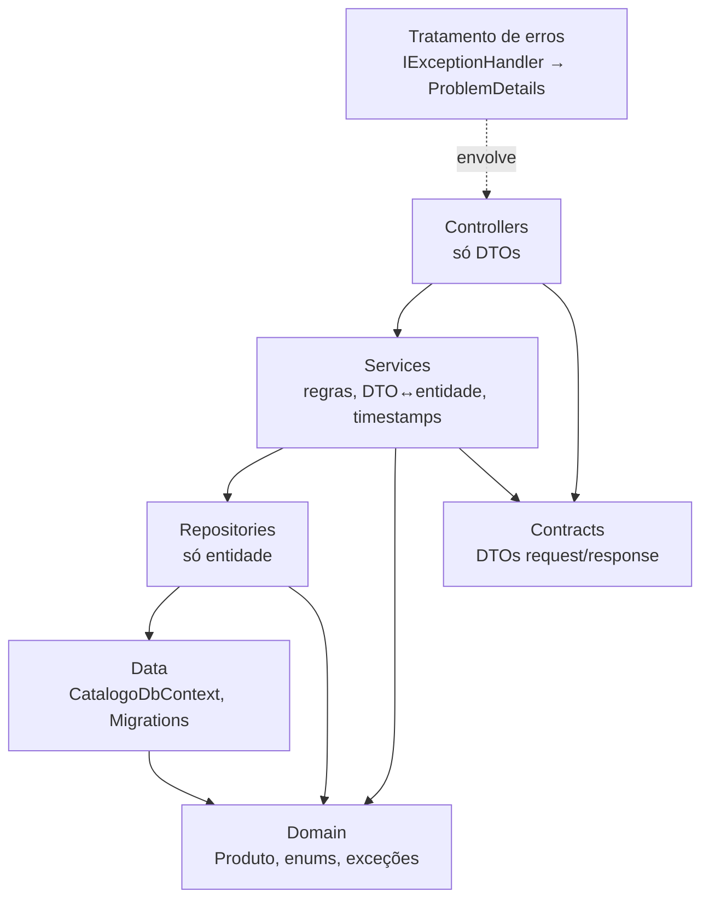
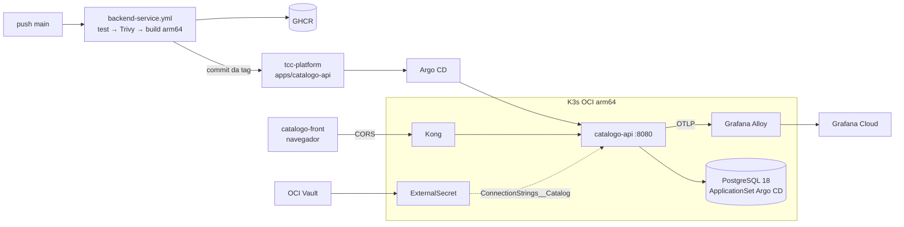

# Architecture Spine — catalogo-api

## Design Paradigm

**Arquitetura em camadas clássica**, num único projeto `CatalogoApi` com uma pasta por camada. A regra de dependência vale por convenção (AD-1), não pelo compilador.



## Invariants & Rules

### AD-1 — Direção de dependência entre camadas [ADOPTED]

- **Binds:** all
- **Prevents:** Controller que acessa o `DbContext` direto, Repository que conhece DTO ou HTTP, regra de negócio espalhada entre camadas.
- **Rule:** As dependências seguem só as setas do diagrama acima. Controllers dependem de interfaces de Service. Services dependem de interfaces de Repository. Só `Repositories/` e `Data/` referenciam EF Core. Controllers não têm regra de negócio: recebem, delegam e devolvem.

### AD-2 — Contrato próprio em cada fronteira [ADOPTED]

- **Binds:** CAP-1..CAP-5
- **Prevents:** a entidade EF ou campos internos vazando no JSON, e dois formatos de produto convivendo na API.
- **Rule:** Controllers recebem e devolvem só tipos de `Contracts/`. O Service converte DTO ↔ `Produto`. O Repository recebe e devolve só `Produto`. Nenhuma entidade é serializada em resposta HTTP. Todo endpoint de produto que devolve um produto devolve `ProdutoResponse`, com o mesmo conteúdo que um `GET` feito logo depois.

### AD-3 — Todo erro sai como ProblemDetails, por um único caminho [ADOPTED]

- **Binds:** all
- **Prevents:** cada controller mapeando erro do seu jeito, ou erros do framework (404, 405, 415) com corpo vazio.
- **Rule:**
  - Services sinalizam falhas lançando exceções de `Domain/Exceptions`: `ProdutoNaoEncontradoException` → 404 e `RegraNegocioException` → 400.
  - Um único `IExceptionHandler`, registrado com `AddProblemDetails()` + `UseExceptionHandler()`, as traduz para **ProblemDetails (RFC 9457)** escrito via `IProblemDetailsService`.
  - Qualquer outra exceção vira 500, sem stack trace no corpo, e é logada.
  - `UseStatusCodePages()` cobre 404/405/415 do framework.
  - Rotas com id usam `{id:int}`.
  - Controllers não usam `try/catch` nem retornam `NotFound()`/`BadRequest()` manualmente.
  - O 400 de model binding sai como `ValidationProblemDetails`.

### AD-4 — Validação em dois níveis, com limites espelhados [ADOPTED]

- **Binds:** CAP-1, CAP-2, CAP-4, CAP-5
- **Prevents:** campo ausente virando valor padrão (`0`, `Ativo`), a mesma regra validada em dois lugares com resultados diferentes, ou entrada aceita pelo DTO estourando no banco (500).
- **Rule:**
  - **Formato e faixa** ficam em DataAnnotations nos DTOs de request (400 automático), e os limites são idênticos na configuração EF:

    | Campo | Limite |
    |---|---|
    | `nome` | 1–200 |
    | `descricao` | ≤ 2000 |
    | `preco` | 0–9 999 999 999,99, no máximo 2 casas |
    | `estoque` | 0–`int.MaxValue` |
    | `pageSize` | 1–100 |

  - Campos obrigatórios de tipo-valor ou enum são **anuláveis + `[Required]`**.
  - `precoMin ≤ precoMax` é validado por `IValidatableObject` em `ListarProdutosQuery`.
  - **Regras que dependem de estado** ficam no Service, via `RegraNegocioException`.
  - Nenhuma validação fica no Controller nem no Repository. Nenhuma entrada aceita pelos DTOs pode gerar 500.

### AD-5 — Ciclo de vida do produto por `Status`, sem remoção [ADOPTED]

- **Binds:** CAP-2, CAP-3, CAP-4, CAP-5
- **Prevents:** um produto desativado sumindo em um endpoint e aparecendo em outro, ou o registro sendo apagado fisicamente.
- **Rule:**
  - `Produto.Status` é o enum `StatusProduto { Ativo, Desativado }`, `Ativo` na criação e persistido como texto.
  - A única mudança de status é `PATCH /produtos/{id}/status` com corpo `{ "status": "<StatusProduto>" }`, e reativar é permitido. Repetir o status atual é idempotente: retorna 200 e não altera `AtualizadoEm`.
  - **Não existe `DELETE`, `Remove()`, `DeletadoEm` nem filtro global de consulta.**
  - Listagem, consulta e edição tratam produtos ativos e desativados igualmente. A listagem traz todos por padrão e aceita o filtro opcional `status`.

### AD-6 — Só o Service muda estado e preenche datas [ADOPTED]

- **Binds:** CAP-1, CAP-4, CAP-5
- **Prevents:** `AtualizadoEm` desatualizado num caminho de escrita, datas vindas do cliente, ou resposta de escrita diferente do `GET` seguinte.
- **Rule:**
  - Toda escrita passa por um método do Service.
  - O Service usa `TimeProvider` e trunca as datas a microssegundos.
  - Na criação, `CriadoEm = AtualizadoEm = agora`. Toda edição e toda mudança efetiva de status atualizam `AtualizadoEm`.
  - O `PUT` é substituição total: `descricao` ausente ou vazia vira `null`.
  - DTOs de request não carregam `Id`, `CriadoEm` nem `AtualizadoEm`, e `Status` só existe no DTO de alteração de status.
  - O Repository só persiste.

### AD-7 — Enums trafegam só pelo nome, com uma única configuração JSON [ADOPTED]

- **Binds:** all
- **Prevents:** API e front trocando números mágicos, OpenAPI descrevendo enums como inteiros, ou grafias diferentes (`"ativo"` × `"Ativo"`).
- **Rule:**
  - Todo parâmetro ou campo com conjunto fechado de valores é enum C# (`CampoOrdenacao`, `DirecaoOrdenacao`, `StatusProduto`).
  - Uma única configuração JSON (camelCase + `JsonStringEnumConverter(namingPolicy: null, allowIntegerValues: false)`) é aplicada a `AddJsonOptions` **e** `ConfigureHttpJsonOptions`. O OpenAPI lê a segunda.
  - A saída é o nome C# exato; a entrada não diferencia maiúsculas.
  - Valor numérico ou fora do enum, na query ou no corpo, retorna 400.

### AD-8 — Configuração só pelo ambiente [ADOPTED]

- **Binds:** all
- **Prevents:** endpoint, segredo ou origem fixos no código, chaves com nomes divergentes entre app e overlay, ou front bloqueado por CORS mal interpretado.
- **Rule:**
  - Chaves próprias da app:

    | Chave | Origem |
    |---|---|
    | `ConnectionStrings__Catalogo` | ExternalSecret |
    | `Cors__OrigensPermitidas` | overlay |
    | `OTEL_*` padrão do SDK | `golden-path/base` |

    Além delas, só as `ASPNETCORE_*`/`DOTNET_*` padrão.
  - Nenhum valor de ambiente fica no repositório; `appsettings.json` só tem padrões não sensíveis.
  - **CORS:**
    - `Cors__OrigensPermitidas` é lido como string, separado por vírgula, com espaços e barra final removidos. Vazio ou `*` derruba o startup.
    - A política permite `GET`/`POST`/`PUT`/`PATCH` e expõe `Location`.
    - A app é a única dona do CORS.

### AD-9 — Schema por migrations EF no startup [ADOPTED]

- **Binds:** all
- **Prevents:** schema criado à mão divergindo do modelo, ou réplicas concorrentes aplicando migrations em paralelo.
- **Rule:**
  - O schema muda só por migration do EF Core, gerada com `dotnet ef` e commitada em `Data/Migrations`.
  - No startup, a app chama `Database.Migrate()` antes de aceitar tráfego. O lock nativo do EF Core 9+ (`LOCK TABLE "__EFMigrationsHistory"` dentro da transação) protege réplicas concorrentes.
  - Migrations sem transação são proibidas, e `EnsureCreated()` também.
  - O usuário do banco precisa de permissão DDL.

### AD-10 — Observabilidade só pelo SDK OpenTelemetry [ADOPTED]

- **Binds:** CAP-7
- **Prevents:** exporter, endpoint ou nome de serviço fixos no código, ou spans faltando numa camada.
- **Rule:** Os traces usam o SDK OpenTelemetry .NET com instrumentação de ASP.NET Core, HttpClient e EF Core, exportando por OTLP. Endpoint, protocolo e `service.name` vêm só de `OTEL_*`. Spans manuais são opcionais; nenhum código substitui a auto-instrumentação.

### AD-11 — Contêiner e health check [ADOPTED]

- **Binds:** CAP-6, Golden Path
- **Prevents:** imagem com shell ou curl só para o health check, build arm64 emulado e frágil, porta divergente das probes, health que responde 200 com o banco fora, ou queda do banco reiniciando todos os pods.
- **Rule:**
  - **Build:** o Dockerfile é multi-stage. O estágio SDK roda em `--platform=$BUILDPLATFORM` e publica com `-a $TARGETARCH`.
  - **Imagem final:** `mcr.microsoft.com/dotnet/aspnet:10.0-noble-chiseled`, `linux/arm64`, sem `RUN`, com o usuário não-root da imagem e porta **8080**.
  - **Dois endpoints de saúde:**
    - `GET /health` (readiness) inclui o check do PostgreSQL. Retorna 200 se saudável e 503 com o banco fora.
    - `GET /health/live` (liveness) não testa dependências: responde 200 enquanto o processo atende.
    - A plataforma deve apontar a liveness para `/health/live` e a readiness para `/health`.
  - **`HEALTHCHECK`:** usa exec form, `["dotnet", "CatalogoApi.dll", "--healthcheck"]`. Esse modo é tratado na primeira linha de `Program.cs`: faz GET em `http://localhost:8080/health/live` e devolve exit 0 ou 1, sem subir o servidor nem rodar migrations.

### AD-12 — Testes contra PostgreSQL real [ADOPTED]

- **Binds:** all
- **Prevents:** testes passando num provider que não se comporta como o Postgres (texto, `decimal`, migrations), ou contrato de enum e OpenAPI quebrando sem ninguém ver.
- **Rule:**
  - Os testes de integração usam `WebApplicationFactory` + Testcontainers PostgreSQL, com a imagem `postgres` na mesma major do cluster (tabela Stack), e aplicam as migrations reais via `Migrate()`.
  - Provider in-memory e SQLite são proibidos.
  - É obrigatório haver casos que provem que `?status=1` retorna 400 e que `/openapi/v1.json` descreve os enums como string.
  - Testes de unidade cobrem o Service com Repository simulado.
  - Tudo roda com `dotnet test --configuration Release` a partir da raiz.

### AD-13 — Runtime .NET 10 em toda a cadeia [ADOPTED]

- **Binds:** all
- **Prevents:** a CI testar num SDK diferente do runtime da imagem (o padrão do template é `9.0.x`).
- **Rule:** O projeto mira `net10.0`, a imagem usa a tag `10.0`, e o `ci.yml` passa `dotnet-version: "10.0.x"` ao `backend-service.yml`. O template compartilhado não é alterado.

## Consistency Conventions

| Concern | Convention |
| --- | --- |
| Idioma dos nomes | Termos de domínio em português (`Produto`, `CriadoEm`, `OrigensPermitidas`). Sufixos técnicos em inglês (`Controller`, `Service`, `Repository`, `Request`, `Response`, `Exception`). |
| Tipos por camada | `ProdutosController`; `IProdutoService`/`ProdutoService`; `IProdutoRepository`/`ProdutoRepository`; `CatalogoDbContext`. |
| DTOs | `CriarProdutoRequest`, `AtualizarProdutoRequest`, `AlterarStatusProdutoRequest`, `ListarProdutosQuery`, `ProdutoResponse`, `PaginaResponse<T>`. |
| Rotas | `POST`/`GET /produtos`, `GET`/`PUT /produtos/{id:int}`, `PATCH /produtos/{id:int}/status`, `GET /health`, `GET /health/live`, `GET /openapi/v1.json`. Recursos no plural e em minúsculas. O Kong encaminha sem prefixo (`strip_path`) e sem plugin `cors`, então a app é servida na raiz. |
| Respostas de sucesso | `POST` → 201 + `Location` + `ProdutoResponse`. `GET`/`PUT`/`PATCH` → 200 + `ProdutoResponse`. Listagem → 200 + `PaginaResponse<ProdutoResponse>`. |
| `ProdutoResponse` | `id`, `nome`, `descricao`, `preco`, `estoque`, `status`, `criadoEm`, `atualizadoEm`. `descricao` é sempre presente, `null` quando vazia. |
| Id | `int` identity gerado pelo banco; número no JSON. |
| JSON | camelCase; membros desconhecidos ignorados. |
| Datas | `DateTimeOffset` em UTC, precisão de microssegundos; ISO-8601 no JSON. |
| Dinheiro | `decimal` em C#, `numeric(12,2)` no banco, número no JSON. |
| Listagem | `{ "itens", "total", "page", "pageSize" }`. `total` conta os registros após os filtros. Página além do fim → 200 com `itens` vazio. `nome` usa `ILIKE` com curingas escapados. `precoMin`/`precoMax` são inclusivos. A ordenação sempre desempata por `Id` crescente. Parâmetros conforme `produto.md` + `status`. |
| Erros | ProblemDetails com `type`, `title`, `status`, `detail`; validação em `errors`, no formato `ValidationProblemDetails`. |
| Logs | `ILogger` com templates estruturados, para stdout; sem dados sensíveis. |

## Stack

| Name | Version |
| --- | --- |
| .NET / ASP.NET Core / EF Core | 10.0 (LTS, suporte até 2028-11-14) |
| Npgsql.EntityFrameworkCore.PostgreSQL | 10.0.3 |
| OpenTelemetry .NET SDK + instrumentações ASP.NET Core / HttpClient | 1.19 |
| OpenTelemetry.Instrumentation.EntityFrameworkCore | 1.19.1-beta.1 |
| Microsoft.AspNetCore.OpenApi | 10.0 |
| Testcontainers.PostgreSql | 4.16.0 |
| Imagem base | `aspnet:10.0-noble-chiseled` (UID 1654, porta 8080) |
| PostgreSQL (cluster e testes) | 18 (a mais recente; subir junto quando o 19 sair, previsto para 2026-10-29) |

## Structural Seed

```text
catalogo-api/
  CatalogoApi.sln
  Dockerfile                    # multi-stage; SDK em $BUILDPLATFORM; final chiseled arm64
  .github/workflows/ci.yml      # dotnet-version 10.0.x; gatilhos push/PR ligados
  src/CatalogoApi/
    Controllers/
    Services/
    Repositories/
    Data/                       # CatalogoDbContext, configurações EF, Migrations/
    Domain/                     # Produto, enums, Exceptions/
    Contracts/                  # DTOs request/response
    Infrastructure/             # IExceptionHandler, configuração JSON/CORS
    Program.cs                  # modo --healthcheck primeiro; DI, OTel, CORS, OpenAPI, health, Migrate
  tests/CatalogoApi.Tests/      # integração (Testcontainers) + unidade
```



Os ambientes hml e prod são overlays/hosts distintos no `tcc-platform`. A mesma imagem serve aos dois; só os valores de ambiente mudam (AD-8).

## Capability → Architecture Map

| Capability / Area | Lives in | Governed by |
| --- | --- | --- |
| CAP-1 cadastrar | `ProdutosController.Criar` → `ProdutoService` → `ProdutoRepository` | AD-1, AD-2, AD-4, AD-6 |
| CAP-2 listar | `ProdutosController.Listar` (`ListarProdutosQuery`) → Service → Repository | AD-4, AD-5, AD-7, convenção Listagem |
| CAP-3 consultar | `ProdutosController.Obter` | AD-3, AD-5 |
| CAP-4 editar | `ProdutosController.Atualizar` | AD-3, AD-4, AD-6 |
| CAP-5 desativar/reativar (redefinido) | `ProdutosController.AlterarStatus` | AD-5, AD-6, AD-7 |
| CAP-6 health | `Program.cs` (`/health`, `/health/live`, modo `--healthcheck`) | AD-11 |
| CAP-7 telemetria | `Program.cs` (OpenTelemetry) | AD-8, AD-10 |
| Golden Path | `Dockerfile`, `ci.yml` | AD-11, AD-13 |

## Open Questions

| Questão | Dono |
| --- | --- |
| O `golden-path/base` precisa apontar a liveness para `/health/live` e a readiness para `/health` (AD-11). | tcc-platform |

## Deferred

| Item | Por que pode esperar |
| --- | --- |
| Concorrência otimista no `PUT` (ETag/`xmin`) | Última escrita vence; com um único consumidor, nenhuma unidade diverge por isso. Revisitar se surgir edição concorrente real. |
| Logs e métricas via OTLP | O contrato exige só traces (CAP-7). Ligar depois não muda nenhuma fronteira. |
| Probes, resources, réplicas, rota Kong | Definidos em `golden-path/base` e no overlay, fora deste repo. |
| Quais `OTEL_*` a plataforma injeta | A app só usa as variáveis padrão do SDK (AD-10); qualquer subconjunto injetado funciona sem mudar código. |
| Provisionamento do PostgreSQL | ApplicationSet do Argo CD no `tcc-platform`; a app só recebe a connection string. |
| Autenticação/autorização | Non-goal do spec. |
| Cache, rate limiting, versionamento de API | Fora do escopo de um CRUD de validação; nenhum consumidor pede. |
